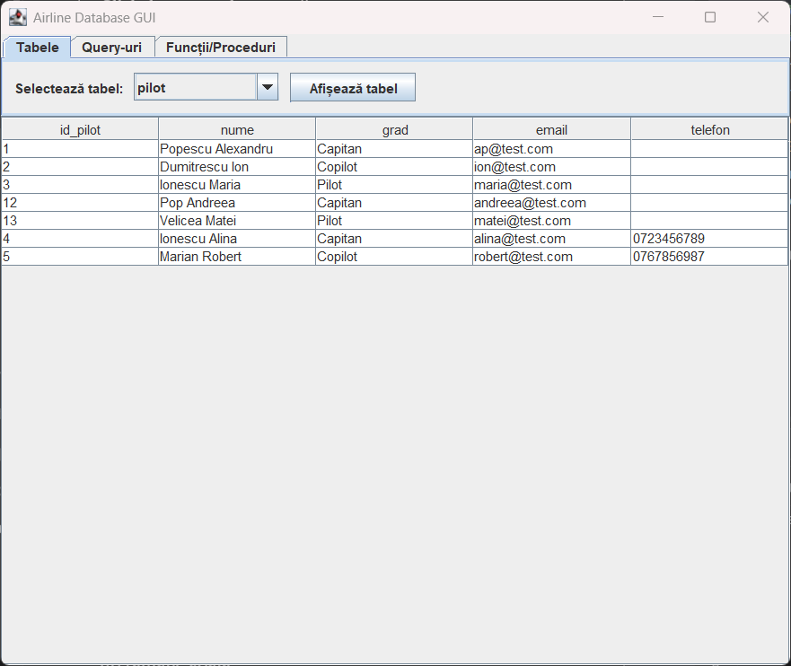
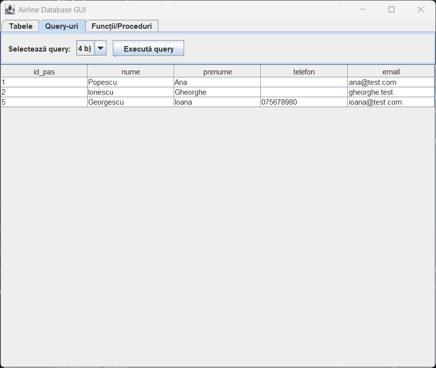
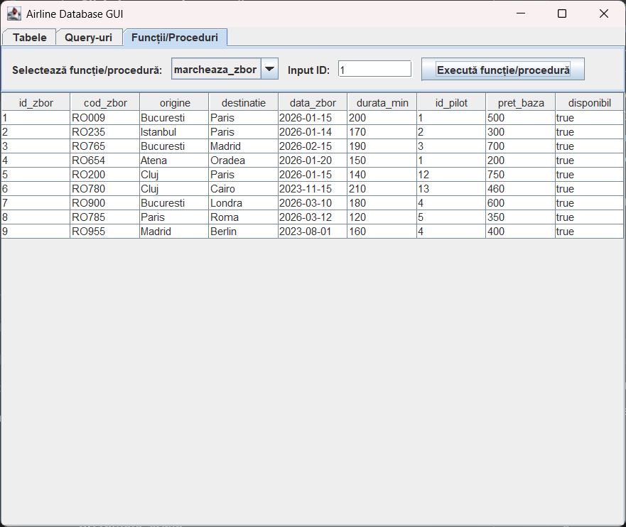

# Airline Reservation Database

A PostgreSQL database for managing airline flight reservations (pilots, flights, passengers, reservations and seat details), together with a small **Java Swing** application for browsing the tables, running the project's queries and calling its stored functions.

Developed as a project for the *Databases* course.

## Screenshots




## Features

* **Relational schema** with five tables, primary and foreign keys and `CHECK` constraints (valid classes, payment methods, reservation statuses, discount range, positive prices).
* **Queries** covering filtering, joins, subqueries and grouping with aggregates.
* **Data modification** examples: inserts, updates and a bulk status change based on a subquery.
* **Triggers** (PL/pgSQL):

  * keeps `rezervare.total` in sync with the sum of its detail rows;
  * rejects a unit price below 50% of the flight's base price;
  * raises an error when a detail is added to a cancelled or non-existent reservation.
* **View** `rezervare\_detaliataB` joining reservations, passengers, flights and details.
* **Stored functions**: `marcheaza\_zbor(id)` marks a flight as unavailable and `calc\_reduceri(id)` returns the total discount of a reservation.
* **Swing GUI** with tabs for tables, predefined queries and functions.

> Table, column and function names and the GUI labels are in Romanian (for example `zbor` = flight, `pasager` = passenger, `rezervare` = reservation).

## Tech stack

|Area|Technology|
|-|-|
|Database|PostgreSQL, PL/pgSQL|
|Application|Java 17+, Swing|
|DB access|JDBC (`org.postgresql:postgresql:42.7.10`)|
|Build|Maven|
|Diagram|draw.io|

## Database design

```mermaid
erDiagram
    PILOT ||--o{ ZBOR : "operates"
    PASAGER ||--o{ REZERVARE : "makes"
    ZBOR ||--o{ REZERVARE : "is booked in"
    REZERVARE ||--o{ DETALIU\_REZERVARE : "contains"

    PILOT {
        int id\_pilot PK
        varchar nume
        varchar grad
        varchar email
        varchar telefon
    }
    ZBOR {
        int id\_zbor PK
        varchar cod\_zbor
        varchar origine
        varchar destinatie
        date data\_zbor
        int durata\_min
        int id\_pilot FK
        int pret\_baza
        boolean disponibil
    }
    PASAGER {
        int id\_pas PK
        varchar nume
        varchar prenume
        varchar telefon
        varchar email
    }
    REZERVARE {
        int id\_rez PK
        int id\_pas FK
        int id\_zbor FK
        date data\_rezervare
        int total
        varchar status
        varchar metoda\_plata
    }
    DETALIU\_REZERVARE {
        int id\_rez FK
        varchar clasa
        varchar loc
        int pret\_unitar
        int reducere\_pct
    }
```

|Table|Meaning|Main constraints|
|-|-|-|
|`pilot`|Pilots and co-pilots|name has at least 3 characters|
|`zbor`|Flights|`pret\_baza > 0`, each flight has one pilot|
|`pasager`|Passengers|none beyond keys|
|`rezervare`|Reservations|`status` in `inregistrata`, `confirmata`, `platita`, `anulata`; `metoda\_plata` is `cash`, `card` or empty|
|`detaliu\_rezervare`|Seat and price per reservation|`clasa` in `Economy`, `Business`, `Premium`; `reducere\_pct` between 0 and 50; `pret\_unitar >= 0`|

The editable draw.io source is in [`docs/er\_diagram.drawio`](docs/er_diagram.drawio).

## Getting started

### Prerequisites

* JDK 17 or newer
* PostgreSQL (the script was tested on PostgreSQL 16)
* An IDE with Maven support, for example IntelliJ IDEA

### 1\. Create the database

```bash
createdb -U postgres airline\_reservation\_database
psql -U postgres -d airline\_reservation\_database -f sql/airline\_reservation.sql
```

You can also open `sql/airline\_reservation.sql` in pgAdmin's Query Tool and run it.

The script creates the tables, constraints, triggers, view and functions, and inserts sample data. Near the end it contains demo inserts that the triggers reject on purpose, so you will see three error messages. This is expected.

### 2\. Configure the connection

By default the app connects to `jdbc:postgresql://localhost:5432/airline\_reservation\_database` as `postgres` with password `postgres`. Override these with environment variables:

|Variable|Default|
|-|-|
|`DB\_URL`|`jdbc:postgresql://localhost:5432/airline\_reservation\_database`|
|`DB\_USER`|`postgres`|
|`DB\_PASSWORD`|`postgres`|

In IntelliJ, set them under **Run → Edit Configurations → Environment variables**, for example `DB\_PASSWORD=your\_password`.

### 3\. Run the application

1. Open the project folder in your IDE and import it as a Maven project.
2. Run `AirlineGUI.main` (`src/AirlineGUI.java`) with the **project root** as working directory, because the app reads the predefined queries from `sql/airline\_reservation.sql`.

`DBConnection.java` also has a `main` method that only checks the database connection.

## Usage

The window has three tabs:

1. **Tabele** (Tables): pick a table and press *Afișează tabel* to show its rows.
2. **Query-uri** (Queries): pick one of the predefined queries and press *Execută query*. The list is read from the `--Query:` comments in the SQL script.
3. **Funcții/Proceduri** (Functions): pick a function, enter an ID and press *Execută funcție/procedură*.

|Query|What it returns|
|-|-|
|3 a)|Flights longer than 180 minutes|
|3 b)|Passengers with an invalid email address|
|3 c)|Flights operated by the pilot Popescu Alexandru|
|4 a)|Passengers with their reservations and flights (join)|
|4 b)|Passengers who booked a flight operated by a captain|
|5 a)|Passengers without any reservation|
|5 b)|Flights that have a confirmed reservation|
|6 a)|Number of flights and average duration per destination|
|6 b)|Number of flights per pilot|

## Project structure

```
.
├── pom.xml
├── sql/
│   └── airline\_reservation.sql    # schema, constraints, sample data, queries, triggers, view, functions
├── src/
│   ├── AirlineGUI.java            # Swing GUI (tables, queries, functions)
│   └── DBConnection.java          # JDBC connection settings
└── docs/
    ├── project\_documentation\_ro.pdf   # project documentation (in Romanian)
    ├── er\_diagram.drawio              # ER diagram (draw.io source)
    └── screenshots/
```

