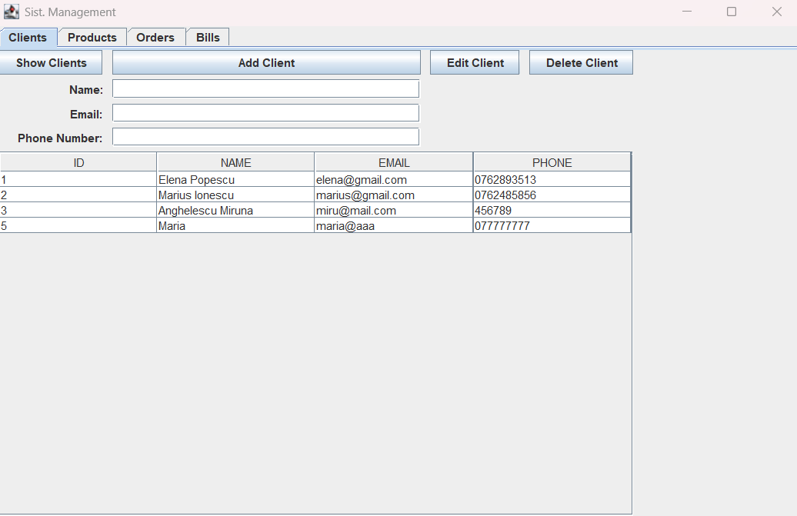
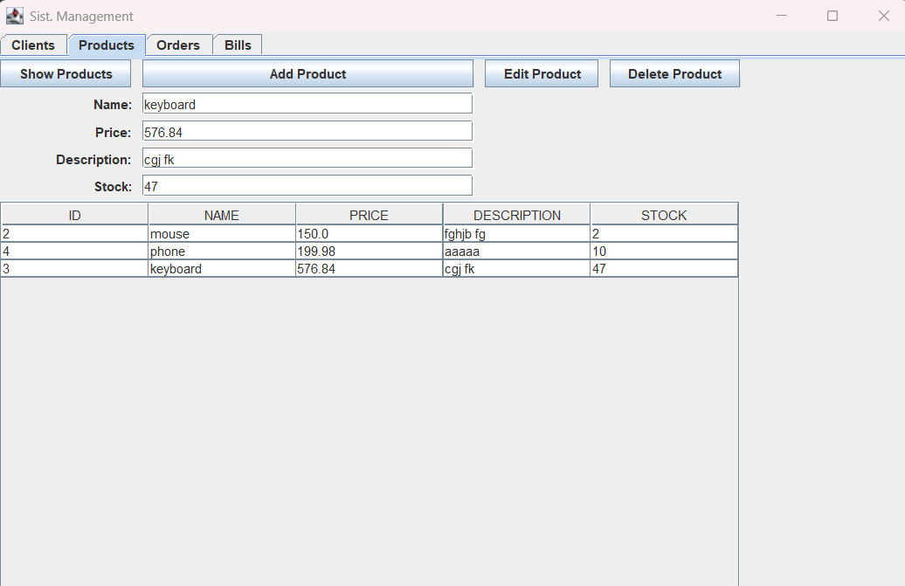
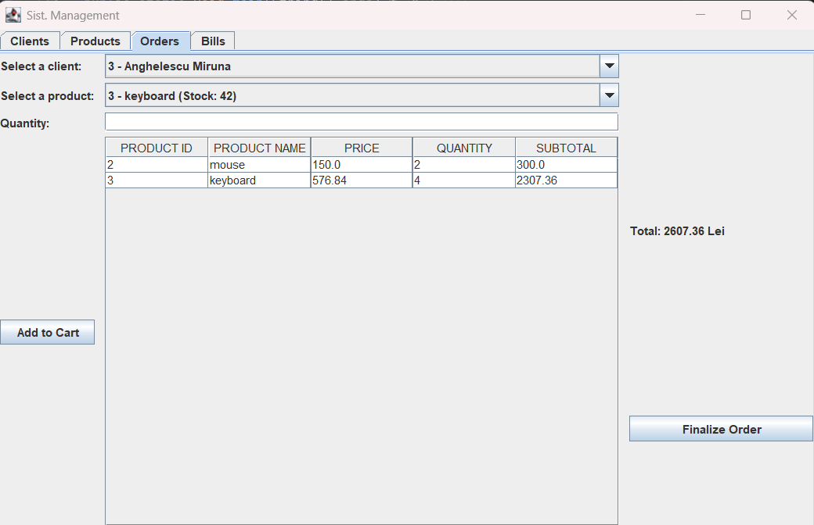
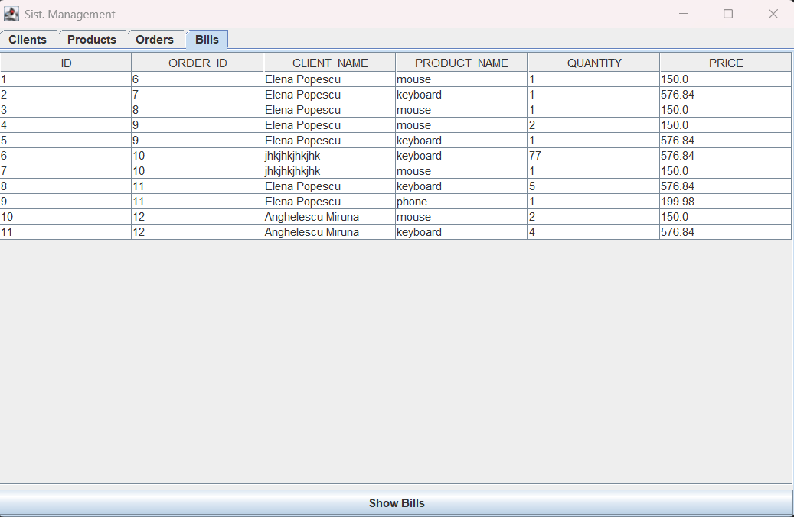

# Order Management System

A desktop application for managing clients, products and orders, built with **Java Swing** and **PostgreSQL**. It follows a layered architecture (presentation → business logic → data access → model) and uses **reflection** to generate generic CRUD queries and tables.

Developed as Assignment 3 for the *Programming Techniques* course.


## Screenshots

| Clients                                      | Products                                       |
|----------------------------------------------|------------------------------------------------|
|  |  |

| Orders                                     | Bills                                    |
|--------------------------------------------|------------------------------------------|
|  |  |

## Features

* **Clients**: add, view, edit and delete clients (with email validation).
* **Products**: add, view, edit and delete products, including price and stock.
* **Orders**: build a separate shopping cart for each client, with stock checks while adding items.
* **Order finalization**: creates the order, decreases product stock, stores the order items and generates a bill. If stock is insufficient, the order is marked `FAILED`.
* **Bills**: every finalized order is logged in a `log` table and shown in the Bills tab.

## Tech stack

|Area|Technology|
|-|-|
|Language|Java 25|
|GUI|Swing (IntelliJ IDEA GUI Designer `.form`)|
|Database|PostgreSQL 18|
|DB access|JDBC (`org.postgresql:postgresql:42.7.10`)|
|Build|Maven|
|Documentation|Javadoc, draw.io diagrams|

## Getting started

### Prerequisites

* JDK 25
* PostgreSQL 18 (with `pg\\\_restore` available)
* IntelliJ IDEA. The GUI is built with the IntelliJ GUI Designer, so the project must be built and run from IntelliJ. Running it with plain `mvn` or `javac` leaves the form components uninitialized.

### 1\. Set up the database

The dump in `src/main/resources` is a PostgreSQL custom-format archive. Restore it with `pg\\\_restore`, not `psql`:

```bash
pg\\\_restore -U postgres -d postgres --clean --if-exists src/main/resources/sql\\\_dump\\\_assignment3.sql
```

This creates the `schema\\\_ass3` schema with the tables `client`, `product`, `orders`, `orderitems` and `log`.

### 2\. Configure the connection

By default the app connects to `jdbc:postgresql://localhost:5432/postgres?currentSchema=schema\\\_ass3` as user `postgres` with password `postgres`. Override these with environment variables:

|Variable|Default|
|-|-|
|`DB\\\_URL`|`jdbc:postgresql://localhost:5432/postgres?currentSchema=schema\\\_ass3`|
|`DB\\\_USER`|`postgres`|
|`DB\\\_PASSWORD`|`postgres`|

In IntelliJ, set them under **Run → Edit Configurations → Environment variables**, for example `DB\\\_PASSWORD=your\\\_password`.

### 3\. Run

1. Open the project folder in IntelliJ IDEA and let Maven import the dependencies.
2. Set the project SDK to JDK 25.
3. Run `src/main/java/org/example/Main.java`.

## Usage

The window has four tabs:

1. **Clients**: press *Show Clients* to load the table. Fill in name, email and phone and press *Add Client*. Click a row to load it into the fields, then use *Edit Client* or *Delete Client*.
2. **Products**: same workflow with name, price, description and stock (*Show Products*, *Add Product*, *Edit Product*, *Delete Product*).
3. **Orders**: choose a client and a product, enter a quantity and press *Add to Cart*. Each client has their own cart and a running total in lei. Press *Finalize Order* to place it.
4. **Bills**: lists all generated bills (*Show Bills*).

## Project structure

```
.
├── pom.xml
├── docs/
│   ├── diagrams/                  # draw.io diagrams (UML / design)
│   └── javadoc/                   # generated Javadoc (open index.html)
└── src/main/
    ├── java/org/example/
    │   ├── Main.java              # application entry point
    │   ├── ConnectionFactory.java # JDBC connection (singleton)
    │   ├── model/                 # Client, Product, Orders, OrderItems, CartItem, Bill
    │   ├── dataAccess/            # AbstractDAO<T> (reflection-based CRUD) + per-entity DAOs
    │   ├── businessLogic/         # ClientBLL, ProductBLL, OrdresBLL, UnderStockException
    │   └── presentation/          # StoreGUI (Swing), TableGenerator (reflection-based tables)
    └── resources/
        └── sql\\\_dump\\\_assignment3.sql
```

## How it works

* **Generic DAO**: `AbstractDAO<T>` reads the generic type and the fields of the model class through reflection. From these it builds the `SELECT`, `INSERT`, `UPDATE` and `DELETE` statements, so each entity DAO is only a few lines long.
* **Generic tables**: `TableGenerator` uses reflection to turn any `List<T>` into a Swing table model.
* **Order flow**: `OrdresBLL.finalizeOrder` inserts the order as `PENDING`, re-checks the stock of every cart item against the database, updates stock, inserts the order items and bill lines, and sets the status to `SUCCESS`. If stock is too low it sets `FAILED` and throws `UnderStockException`.

## Database schema

|Table|Main columns|
|-|-|
|`client`|`id`, `name`, `email`, `phone`|
|`product`|`id`, `name`, `price`, `description`, `stock`|
|`orders`|`id`, `status`, `client\\\_id` → `client`, `total\\\_sum`|
|`orderitems`|`id`, `order\\\_id` → `orders`, `product\\\_id` → `product`, `quantity` (> 0)|
|`log`|`id`, `order\\\_id`, `client\\\_name`, `product\\\_name`, `quantity`, `price` (the bills)|

## Documentation

Open `docs/javadoc/index.html` in a browser for the full API documentation.

## 

